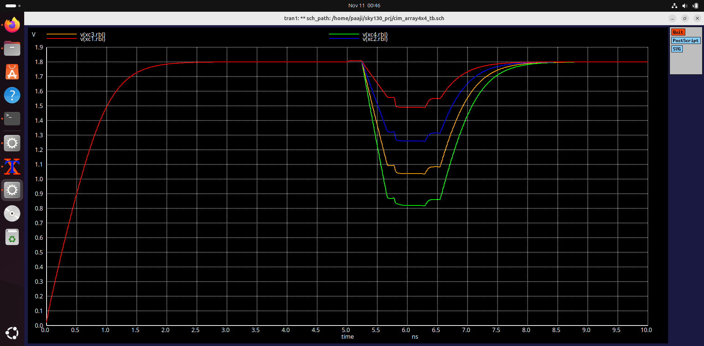

# In-Situ Weight-Integrity Checking on an 8T SRAM Compute-in-Memory Array (SkyWater 130 nm)

This is an ongoing project in which I am designing an 8T SRAM compute-in-memory (CIM) array at the transistor level in the open-source SkyWater 130 nm PDK, using Xschem and ngspice.

## Goal

Flipping a few chosen weight bits in memory can destroy a DNN's accuracy [9]. RADAR [8] defends against this by keeping a small checksum per weight group and checking it at run time, but the weights are read out of memory to be checked.

I want to see whether this check can be done inside the memory array itself. In a CIM array, turning on several rows at once makes the read bitline voltage reflect how many stored bits are 1, the same operation used for multiply-accumulate. Taking that count modulo 4 gives a 2-bit signature, similar in size to RADAR's, without moving the weights out of the array. The last phase will compare the energy of this in-array check against reading the weights out to a digital checksum circuit.

I have split the work into three phases:

| Phase | Content | Status |
|---|---|---|
| 1 | 8T bitcell, two-row read, sense amplifiers, in-array AND / NOR / XOR | Done |
| 1.5 | 4×4 array that counts the 1s in each column (0 to 4) | Done |
| 2 | Signature from the column count, golden-signature compare, fault injection | Not started |

---

## Phase 1: In-array Boolean logic

*Time spent: about 5 days (Oct 20 – Oct 24, 2026)*

### What it does

Two bits A and B are stored in two 8T cells on the same column. Both read wordlines are turned on together, and the read bitline (RBL), which was precharged to 1.8 V, discharges by an amount that depends on how many of the two cells hold a 1. After a fixed 0.7 ns read window, the RBL sits at one of three levels. Two StrongARM comparators compare it against two reference voltages, and an SR latch after each comparator holds the result once the comparator resets.

Since AND, NOR and XOR of two bits depend only on how many of them are 1, the two comparator decisions are enough:

- count = 0 gives NOR
- count = 2 gives AND
- count = 1 gives XOR, which needs one extra gate (OR · NAND)

The 8T cell is used instead of 6T because its read port only uses the stored node as a transistor gate, so activating two rows at once cannot flip either cell. The cell topology is the standard 8T cell [1], and the multi-row read scheme follows [2] and [3].

### Results (TT, 27 °C, 1.8 V)

Bitcell:

| Metric | Value |
|---|---|
| Write 1 / write 0 time | 118 ps / 57 ps |
| RBL after reading a 1 / a 0 (0.7 ns, 200 fF) | 1.422 V / 1.805 V |
| Stored node during read | stays above 1.787 V (no read disturb) |
| Precharge back to 1.75 V | 0.71 ns |

Two-row column:

| A B | Count | RBL |
|---|---|---|
| 0 0 | 0 | 1.804 V |
| 1 0 / 0 1 | 1 | 1.423 V / 1.420 V |
| 1 1 | 2 | 1.051 V |

The references were set at the midpoints, 1.61 V and 1.24 V. The full unit produced the correct AND, NOR and XOR for all four input combinations.

Process corners (the full logic unit):

| Corner | Result |
|---|---|
| TT | correct |
| FF | correct |


### Problems I ran into

- My first netlist had the bodies of three nfets (both write access devices and the read access device) tied to their own sources instead of to ground. It simulated, but it is not buildable in sky130 and it hides the body effect. I caught it while checking the netlist line by line.
- The precharge pfet was too weak at first and took 1.45 ns to restore the bitline. Widening it from 1 µm to 2 µm brought this down to 0.71 ns.
- I originally planned to detect the levels with skewed inverters, as X-SRAM does [3]. With levels this close to VDD (about 1.6 V for the upper threshold), an inverter cannot be skewed far enough in sky130, so I switched to clocked StrongARM comparators [4, 5]. Because a StrongARM resets every cycle, I added an SR latch after each one, as in sense-amplifier flip-flops [6].
- While re-running everything for this README, the two-row testbench gave levels that no longer matched my earlier run. The cause was the second cell's ground pin, which had been left on an unconnected net. Its read path had nothing to discharge into.
---

## Phase 1.5: 4×4 multi-row MAC

*Time spent: about 7 days (Nov 5 – Nov 11, 2026)*

### What it does

Each column now has four cells, and all four read wordlines are turned on together, so the RBL settles at one of five levels depending on how many of the four cells hold a 1. Four comparators with four references produce a thermometer code (T1 to T4, where Tk = 1 when the count is at least k), and a small encoder made of four NAND gates and two inverters converts it to a 3-bit binary count. The lower two bits of this count (count mod 4) are what Phase 2 will use as the signature.

The 4×4 array is four of these columns sharing the same wordlines, so a single read produces four counts at once.

### Results (TT, 27 °C, 1.8 V)

Choosing the read window: with the 0.7 ns window from Phase 1, the levels bunched up near the bottom and count 4 fell to 0.39 V, which is too low for the nfet input pair of the comparator. Shortening the window to 0.45 ns gave five evenly spaced levels:

| Count | RBL | Step | Base paper [2], 90 nm |
|---|---|---|---|
| 0 | 1.793 V | | 1.758 V |
| 1 | 1.553 V | 240 mV | 1.528 V |
| 2 | 1.308 V | 245 mV | 1.308 V |
| 3 | 1.068 V | 240 mV | |
| 4 | 0.836 V | 232 mV | |

Storing 0101 instead of 1100 (both count 2) gave a level within 7 mV, so the result depends only on the count and not on which rows hold the 1s. The references were set at the midpoints: 1.673 V, 1.430 V, 1.188 V and 0.952 V.

Single column, written and read with six patterns:

| Stored (rows 1–4) | Count | Output |
|---|---|---|
| 0000 | 0 | 000 |
| 1000 | 1 | 001 |
| 1100 | 2 | 010 |
| 1110 | 3 | 011 |
| 1111 | 4 | 100 |
| 0101 | 2 | 010 |

4×4 array, one read:

| Column | Stored | Output |
|---|---|---|
| 1 | 1000 | 001 |
| 2 | 1100 | 010 |
| 3 | 1110 | 011 |
| 4 | 1111 | 100 |




### Problems I ran into

- The first full-column run read count 1 as count 0. Probing the first comparator showed that it was deciding the wrong way: the bitline was at about 1.50 V against a 1.673 V reference, yet the wrong output fell. Both comparator outputs were sagging to around 0.95 V before one of them recovered, which meant the regeneration was weak, and the SR latch, still holding the previous result, loaded the two outputs unequally. Doubling the width of the comparator's pfet latch pair (1 µm to 2 µm) fixed it. I then re-ran the Phase 1 logic unit at TT with the new comparator and it still passed.
- When the comparators fire, every bitline steps down by about 60 mV (kickback onto the floating 200 fF bitline). It does not cause errors here, but it eats into the margin and will matter if the levels get closer together.
---

## Design details

| Block | Details |
|---|---|
| 8T bitcell | pull-down 0.84 µm, pull-up 0.42 µm, write access 0.42 µm, read stack 0.42 µm, all L = 0.15 µm |
| Precharge | pfet, W = 2 µm |
| Bitline load | 200 fF (as in [2]) |
| Comparator | StrongARM latch [4, 5], Razavi's Fig. 1(b); tail and input pair 2 µm, nfet latch 1 µm, pfet latch 2 µm, reset devices 0.42 µm |
| Output latch | two cross-coupled NAND2 gates |
| Logic | NAND2 (0.84 / 0.84 µm) and inverter (0.84 / 0.42 µm) |
| Encoder | thermometer to binary, as used in flash ADCs [7] |

Drivers and reference voltages are ideal sources, and everything is at schematic level for now (no layout or extracted parasitics).

## Files

```
*.sch, *.sym    Xschem schematics and symbols
spice/          netlists exported from Xschem
results/        ngspice logs and waveform screenshots
```

Requires the sky130A PDK (open_pdks), Xschem and ngspice. To run a testbench in batch mode:

```
ngspice -b spice/cim_col4_tb.spice
```

Other corners can be run by changing `tt` to `ss` or `ff` on the `.lib` line.

## References

1. L. Chang et al., "An 8T-SRAM for variability tolerance and low-voltage operation in high-performance caches," IEEE JSSC, vol. 43, no. 4, 2008.
2. Amogh K M and Sunita M S, "A Novel 8T SRAM-Based In-Memory Computing Architecture for MAC-Derived Logical Functions," arXiv:2512.00441, 2025.
3. A. Agrawal et al., "X-SRAM: Enabling in-memory Boolean computations in CMOS static random access memories," IEEE TCAS-I, 2018.
4. B. Razavi, "The StrongARM latch," IEEE Solid-State Circuits Magazine, vol. 7, no. 2, 2015.
5. T. Kobayashi et al., "A current-controlled latch sense amplifier and a static power-saving input buffer for low-power architecture," IEEE JSSC, 1993.
6. B. Nikolić et al., "Improved sense-amplifier-based flip-flop: Design and measurements," IEEE JSSC, vol. 35, no. 6, 2000.
7. D. Johns and K. Martin, Analog Integrated Circuit Design, Wiley (chapter on flash A/D converters).
8. J. Li, A. S. Rakin, Z. He, D. Fan and C. Chakrabarti, "RADAR: Run-time adversarial weight attack detection and accuracy recovery," DATE, 2021.
9. A. S. Rakin, Z. He and D. Fan, "Bit-flip attack: Crushing neural network with progressive bit search," ICCV, 2019.
